<div align="center">

# ⚡ Predicting Transformer Health Index with Machine Learning

**How much of a transformer's condition can be predicted from its oil?**<br>
A side-by-side benchmark of 13 regression models trained on Dissolved Gas Analysis (DGA) and oil-quality measurements.


[](LICENSE)

</div>

---

## 🎯 In one minute

| | |
|---|---|
| **Task** | Regression: predict a continuous **Health Index** for oil-immersed power transformers |
| **Inputs** | 9 dissolved gases + 5 oil-quality parameters (14 features) |
| **Data** | ~470 transformers, public Mendeley dataset |
| **Approach** | 13 algorithms, one shared 80/20 split, hyperparameters tuned with 5-fold CV where applicable |
| **Best test R²** | **Gradient Boosting: 0.7706** (RMSE 8.86) |
| **Lowest test MAE** | **Random Forest: 6.04** |
| **Main lesson** | Tree-based models clearly beat linear ones, and adding complexity without control backfires |

---

## 💬 Why this project?

Transformer failures are expensive and disruptive. Utilities already sample transformer oil routinely to measure dissolved gases, moisture, dielectric strength and more. Turning those readings into a single condition score usually depends on expert rules.

We wanted to test a simple idea: **can standard machine-learning regressors learn that mapping directly from the measurements?** If so, which kinds of models do it best, and where do they break down?

Rather than tuning one favourite algorithm, we put **13 models** through the *same* pipeline and the *same* held-out test set. That way the comparison itself is the result.

---

## 📈 Leaderboard

All scores are on the **same 94-sample test set**. *Gap* = Train R² − Test R², a quick measure of how much a model memorised rather than learned.

| # | Model | Train R² | **Test R²** | Test MAE | Test RMSE | Gap | Fit label |
|:-:|---|:-:|:-:|:-:|:-:|:-:|:-:|
| 1 | Gradient Boosting | 0.8140 | **0.7706** | 6.2629 | **8.8641** | 0.04 | 🟢 Best fitting |
| 2 | Decision Tree | 0.7475 | 0.7641 | 6.2245 | 8.9876 | −0.02 | 🟢 Best fitting |
| 3 | Random Forest | 0.9453 | 0.7638 | **6.0380** | 8.9939 | 0.18 | 🔴 Overfitting |
| 4 | XGBoost | 0.8391 | 0.7572 | 6.6131 | 9.1196 | 0.08 | 🟢 Best fitting |
| 5 | AdaBoost | 0.7378 | 0.7228 | 7.2068 | 9.7434 | 0.02 | 🟢 Best fitting |
| 6 | KNN | 1.0000 | 0.5332 | 8.4592 | 12.6445 | 0.47 | 🔴 Overfitting |
| 7 | SVR (RBF) | 0.8042 | 0.5284 | 8.2826 | 12.7089 | 0.28 | 🔴 Overfitting |
| 8 | Elastic Net | 0.5029 | 0.5194 | 9.5501 | 12.8295 | −0.02 | 🟠 Underfitting |
| 9 | Ridge | 0.5046 | 0.4970 | 9.6216 | 13.1252 | 0.01 | 🟠 Underfitting |
| 10 | Multiple Linear | 0.5046 | 0.4956 | 9.6272 | 13.1437 | 0.01 | 🟠 Underfitting |
| 11 | Lasso | 0.4798 | 0.4529 | 10.1457 | 13.6888 | 0.03 | 🟠 Underfitting |
| 12 | Simple Linear | 0.2054 | 0.2651 | 13.0016 | 15.8652 | −0.06 | 🟠 Underfitting |
| 13 | Polynomial (deg 2) | 0.7882 | −0.1210 | 12.6020 | 19.5938 | 0.91 | 🔴 Overfitting |

<sub>Fit labels come from a fixed rule in the notebook: <b>Underfitting</b> if both R² &lt; 0.6, <b>Overfitting</b> if the gap &gt; 0.15, otherwise <b>Best fitting</b>. Raw numbers: <a href="results/model_comparison.csv"><code>results/model_comparison.csv</code></a>.</sub>

<p align="center">
  
</p>

> **Which metric should I look at?**
> **R²** is the share of Health Index variation the model explains (1.0 = perfect, below 0 = worse than predicting the mean).
> **MAE** is the average size of an error, in Health Index points.
> **RMSE** is like MAE but punishes large misses more heavily.
> Gradient Boosting wins on R² and RMSE, while Random Forest wins on MAE, so "best model" depends on which kind of error matters more to you.

---

## 🔎 Four observations

### ① Going from one feature to fourteen roughly doubles R², but linear models stall around 0.5
Simple Linear Regression uses only the most correlated feature (DBDS) and reaches **0.27**. Using all 14 features lifts Multiple Linear Regression to **0.50**. Ridge, Lasso and Elastic Net then add almost nothing. Regularisation can't fix a model whose basic shape (a straight line) is the limitation.

### ② The jump to tree-based models is the biggest step in the table
All five tree-based models score **above 0.72**, a gain of more than 0.2 R² over the best linear model. Trees split the data into regions and capture interactions between variables, which suggests the Health Index depends on DGA readings in a **non-linear, threshold-like** way.

### ③ Complexity has to be controlled, not just added
Three models fit the training data well but fall apart on the test set:
- **Polynomial (deg 2)** creates 119 features from 14 and drops to a **negative** test R² (gap 0.91).
- **KNN** with distance weighting reproduces the training data exactly (train R² = 1.00) but reaches only 0.53 on unseen samples.
- **SVR (RBF)** shows a similar pattern (gap 0.28).

In contrast, Gradient Boosting with shallow trees (`max_depth = 2`), a slow learning rate and row subsampling keeps its gap at just **0.04**.

### ④ A few measurements carry most of the signal
In Random Forest, **DBDS, Methane, Hydrogen and Interfacial voltage** together account for about **two-thirds** of feature importance. XGBoost ranks the same group at the top, in a slightly different order. These are *predictive associations* within this dataset, not proof of cause and effect.

<table>
<tr>
<td>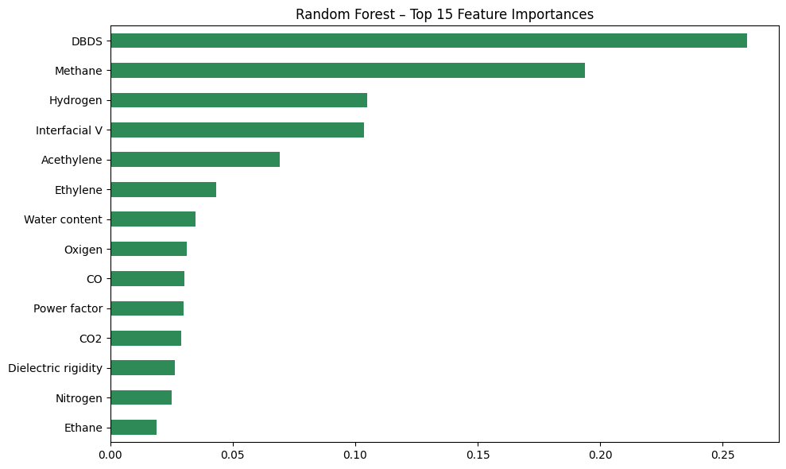</td>
<td>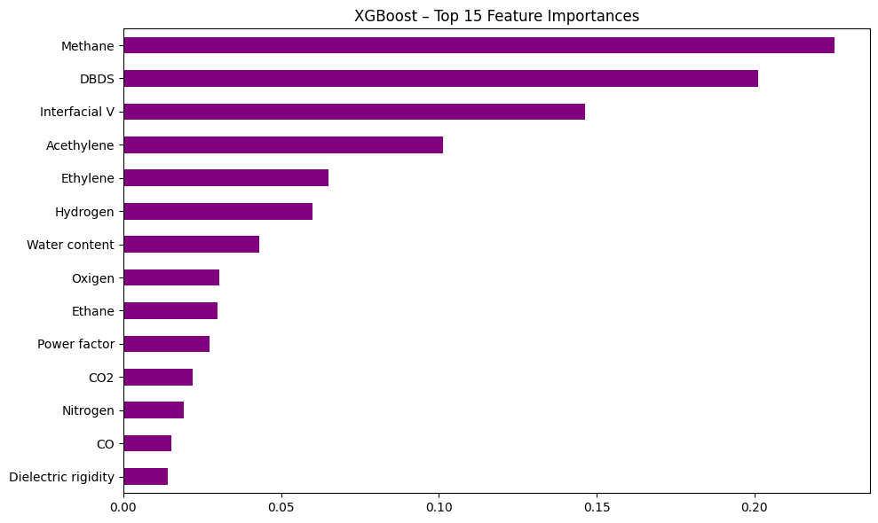</td>
</tr>
<tr><td align="center">Random Forest</td><td align="center">XGBoost</td></tr>
</table>

---

## 🖼️ Visual comparison

<table>
<tr>
<td></td>
<td></td>
</tr>
<tr>
<td align="center">Train vs test R²: long blue bar + short orange bar = overfitting</td>
<td align="center">Test MAE and RMSE: shorter is better</td>
</tr>
</table>

**Predicted vs actual (top three models).** Points on the black line are perfect predictions. The horizontal bands appear because the Health Index takes only a limited set of distinct values in this dataset.

<table>
<tr>
<td>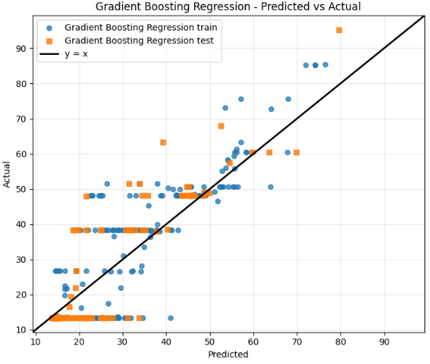</td>
<td>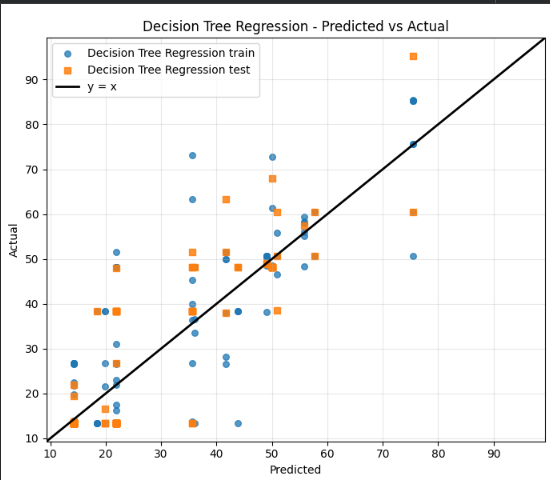</td>
<td>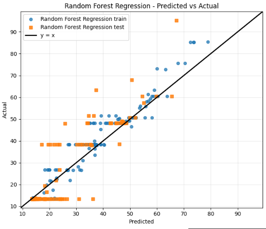</td>
</tr>
<tr>
<td align="center">Gradient Boosting</td><td align="center">Decision Tree</td><td align="center">Random Forest</td>
</tr>
</table>

<details>
<summary><b>📂 Expand: predicted-vs-actual plots for the other 10 models</b></summary>
<br>
<table>
<tr>
<td>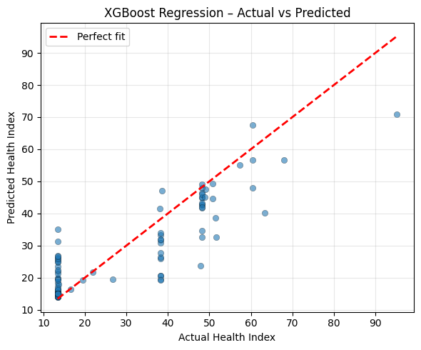</td>
<td>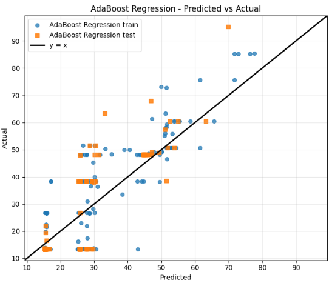</td>
<td>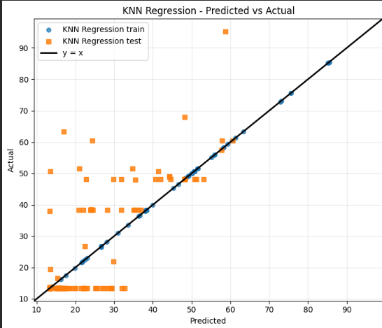</td>
</tr>
<tr>
<td>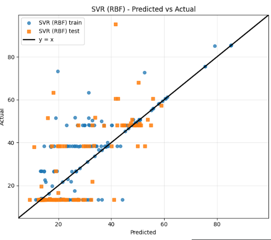</td>
<td>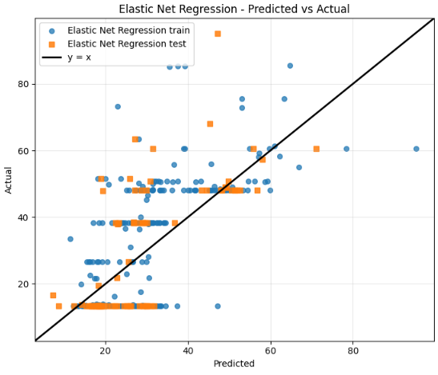</td>
<td>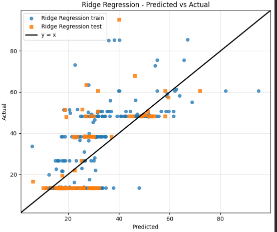</td>
</tr>
<tr>
<td>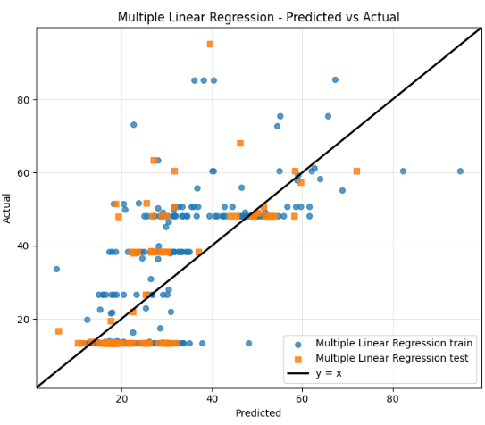</td>
<td>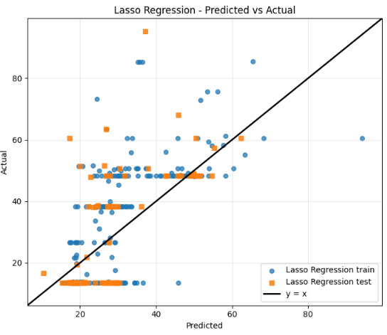</td>
<td>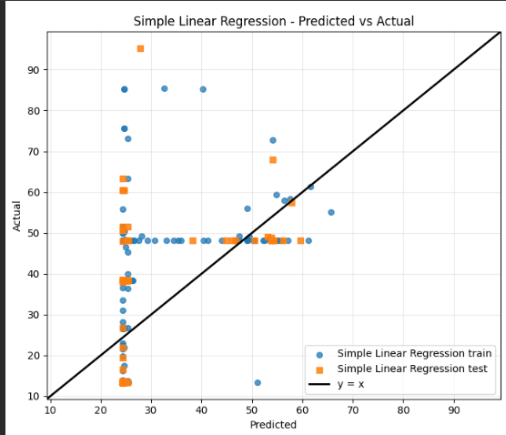</td>
</tr>
<tr>
<td>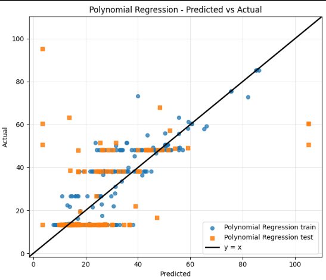</td>
<td></td><td></td>
</tr>
</table>
</details>

<details>
<summary><b>🌡️ Expand: full metrics heatmap and feature correlation matrix</b></summary>
<br>

<br><br>
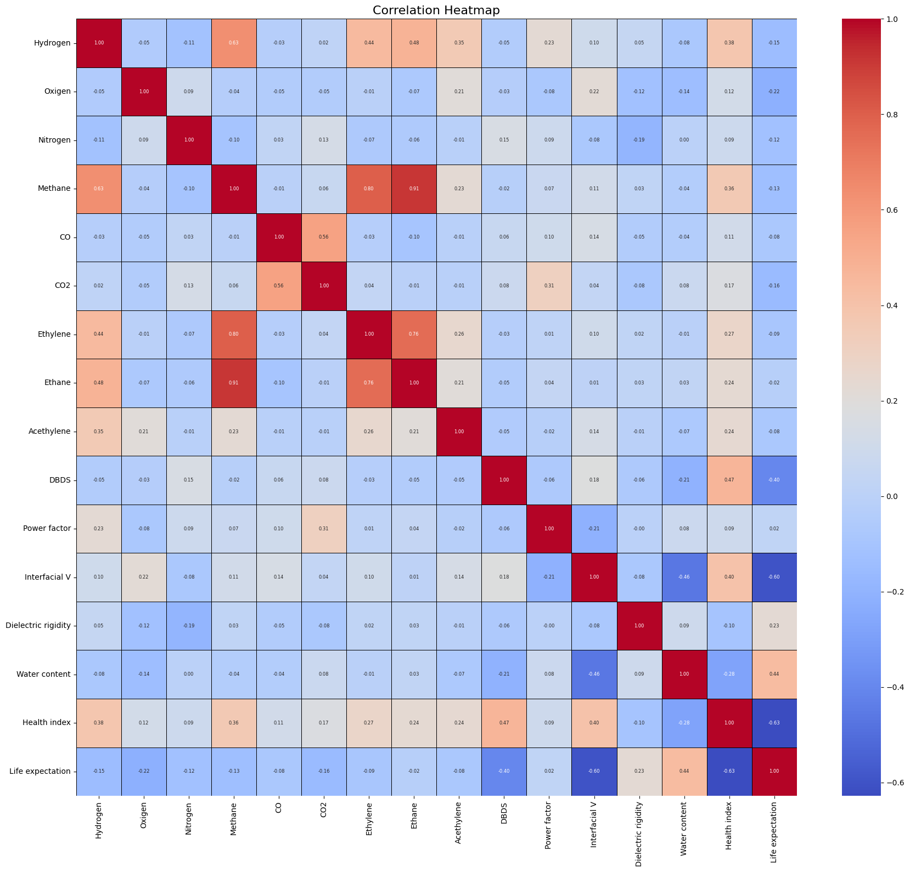
</details>

---

## 🛠️ How the experiment was set up

```
 ┌──────────────┐   ┌──────────────────────┐   ┌──────────────────┐
 │  Raw CSV     │──▶│  Clean               │──▶│  Split 80 / 20   │
 │  470 × 16    │   │  • drop missing HI   │   │  376 train       │
 └──────────────┘   │  • median-impute     │   │  94 test         │
                    │  • drop Life expect. │   │  seed = 42       │
                    └──────────────────────┘   └────────┬─────────┘
                                                        │
      ┌───────────────────┬───────────────────┬─────────┴─────────┬───────────────────┐
      ▼                   ▼                   ▼                   ▼                   ▼
 ┌──────────┐      ┌─────────────┐     ┌────────────┐      ┌────────────┐      ┌─────────────┐
 │ Linear   │      │ Regularised │     │ Polynomial │      │ KNN · SVR  │      │ Trees &     │
 │ (2)      │      │ (3)         │     │ (1)        │      │ (2)        │      │ ensembles(5)│
 └────┬─────┘      └──────┬──────┘     └─────┬──────┘      └─────┬──────┘      └──────┬──────┘
      └───────────────────┴──────────────────┴───────────────────┴────────────────────┘
                                             │
                          ┌──────────────────▼──────────────────┐
                          │  Score on test set: R² · MAE · RMSE │
                          │  Label fit: under / over / best     │
                          └─────────────────────────────────────┘
```

| Step | Detail |
|---|---|
| Missing values | Rows without a Health Index are dropped. Other numeric gaps are filled with the column median. |
| Excluded column | **Life expectation** is removed. The project report describes it as derived from Health Index, so keeping it would leak the answer into the inputs. |
| Scaling | `StandardScaler` for scale-sensitive models (Ridge, Lasso, Elastic Net, Polynomial, SVR, KNN). |
| Tuning | `GridSearchCV` with 5 folds and R² scoring for KNN, Decision Tree, Random Forest, AdaBoost, Gradient Boosting and XGBoost. `LassoCV` is used for Lasso. |
| Split | Single 80/20 hold-out, `random_state = 42`, shared by every model. |

<details>
<summary><b>⚙️ Expand: tuned hyperparameters</b></summary>

| Model | Selected parameters | CV R² |
|---|---|:-:|
| Gradient Boosting | `n_estimators=100, learning_rate=0.05, max_depth=2, subsample=0.6` | 0.677 |
| XGBoost | `n_estimators=400, learning_rate=0.01, max_depth=3, subsample=1.0, colsample_bytree=0.7` | 0.680 |
| Random Forest | `n_estimators=300, max_depth=10, max_features=0.5` | 0.665 |
| AdaBoost | `n_estimators=300, learning_rate=0.01` (base learner: depth-3 tree) | 0.636 |
| Decision Tree | `max_depth=4, min_samples_leaf=5` | 0.544 |
| KNN | `n_neighbors=7, weights=distance, metric=euclidean` | 0.481 |
| Lasso | `alpha ≈ 0.912` (LassoCV; 5 features set to zero) | – |
| SVR | `kernel=rbf, C=100, gamma=0.1, epsilon=0.1` (fixed) | – |
| Elastic Net | `alpha=0.1, l1_ratio=0.5` (fixed) | – |

</details>

---

## 🧪 Data

**Source:** *"Data for: Root cause analysis improved with machine learning for failure analysis in power transformers"* by Ricardo Arias and Jennifer Mejia Lara, [Mendeley Data `rz75w3fkxy`](https://data.mendeley.com/datasets/rz75w3fkxy).

| Group | Variables |
|---|---|
| 🫧 Dissolved gases | Hydrogen · Oxygen · Nitrogen · Methane · CO · CO₂ · Ethylene · Ethane · Acetylene |
| 🛢️ Oil quality | DBDS · Power factor · Interfacial voltage · Dielectric rigidity · Water content |
| 🎯 Target | Health Index |
| 🚫 Excluded | Life expectation |

The CSV is **not** committed to this repository. Download instructions and the exact column names (which keep the source spellings, e.g. `Oxigen`, `Acethylene`) are in [`data/README.md`](data/README.md).

---

## 🗂️ What's in this repository

```
transformer-health-index-prediction/
├── notebooks/   transformer_health_index_prediction.ipynb  ← the full experiment, with outputs
├── src/         script version: train.py · predict.py · models.py · evaluate.py · data.py · config.py
├── data/        README.md (how to get the data) · sample_input.csv
├── results/     model_comparison.csv · figures/{comparison, parity, feature_importance, eda}
├── models/      saved best model (created by src.train; git-ignored)
├── docs/        project_report.docx · project_presentation.pptx
├── requirements.txt · CITATION.cff · LICENSE
```

**Where to start:**
- Just want the findings? Read this page, then [`docs/project_report.docx`](docs/project_report.docx).
- Want to see the code? Open the notebook.
- Want to re-run everything? Use `src/`.

---

## ▶️ Reproduce it

```bash
git clone https://github.com/<your-username>/transformer-health-index-prediction.git
cd transformer-health-index-prediction
pip install -r requirements.txt
```

Then download the dataset to `data/Health index1.csv` and choose one of the following:

| Option | Command | What you get |
|---|---|---|
| **Notebook** | `jupyter notebook notebooks/transformer_health_index_prediction.ipynb` | Every step, plot and printout from the original study |
| **Script** | `python -m src.train` | All models retrained, a new comparison CSV, parity plots and `models/best_model.joblib` |
| **Predict** | `python -m src.predict --input data/sample_input.csv` | Health Index predictions for new oil samples |

The notebook detects whether it is running in **Google Colab**, where it reads from `/content/drive/MyDrive/`, or locally, where it reads from `data/`.

> **Reproducibility note:** The figures and numbers on this page come from the notebook's saved outputs. The `src/` version mirrors the notebook with two small differences: Ridge is tuned with `RidgeCV` on training data only, and polynomial predictions are not clipped. Those two rows may therefore differ slightly. Library versions can also cause small variations in tree-based results.

---

## ⚠️ Read this before drawing conclusions

- **Small sample.** About 470 transformers with a 94-sample test set. A different random split could reorder models whose scores are close (positions 1 to 4 are within 0.014 R² of each other).
- **One split, no repeated CV.** The ranking reflects a single hold-out evaluation.
- **This is Health Index regression, not fault diagnosis.** The models estimate an overall condition score; they do not identify fault types.
- **Association, not causation.** High feature importance means a variable helps prediction in this dataset, not that it drives transformer health.
- **No external validation.** Results have not been tested on transformers from another utility, region or time period, so this is not a deployable diagnostic tool.

## 🔭 Ideas for extending it

- Repeated or nested cross-validation to get confidence intervals on each model's score
- Log-transforming the heavily skewed gas concentrations
- Adding classic DGA ratio features (Rogers, Doernenburg, Duval triangle)
- SHAP values to explain individual predictions
- Validation on an independent transformer dataset

---

## 👥 Team

Built for **23ELC212 – Machine Learning**, Department of Electrical & Electronics Engineering, Amrita School of Engineering, Coimbatore (Amrita Vishwa Vidyapeetham), March 2026.

**Sanjith M P** · **Swagat A** · **Swetraj Ravishwaran** · **Vedhanth M R**

**Faculty guide:** Mr. Nakkeeran M, Assistant Professor (OC), EEE

## 📖 Cite

```bibtex
@misc{transformer_hi_ml_2026,
  title  = {Machine Learning Based Prediction of Transformer Health Index using Dissolved Gas Analysis Parameters},
  author = {Sanjith M P and Swagat A and Swetraj Ravishwaran and Vedhanth M R},
  year   = {2026},
  note   = {Course project, 23ELC212 Machine Learning, Amrita Vishwa Vidyapeetham, Coimbatore}
}
```

Please also cite the original dataset authors (see [`data/README.md`](data/README.md)).

---

<sub>📝 An academic course project that documents an experiment and its results. It is not a production transformer-monitoring system. Code is released under the <a href="LICENSE">MIT License</a>.</sub>
